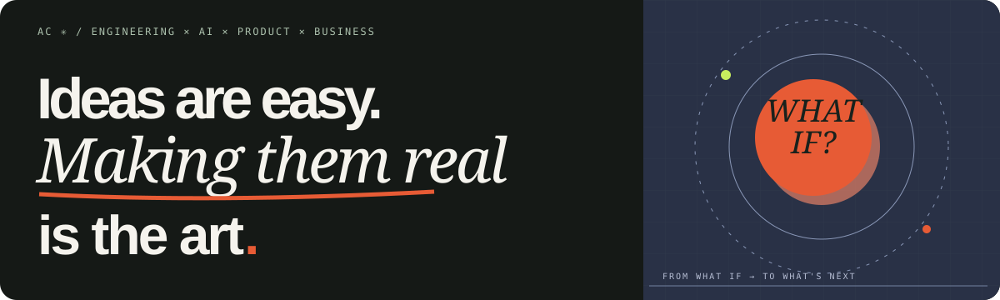

 

### Hey, I'm Abhishek. 👋

**Engineering leader · Product thinker · Independent builder**

I work where **engineering, AI, product, and business** meet. I like the entire journey: finding the interesting problem, questioning assumptions, making something real, and learning from the result.

[**Explore my website ↗**](https://abhishekchaudhary.github.io/abhishekchaudhary/) &nbsp; · &nbsp; [**Find me on X ↗**](https://x.com/now_abhi_)

---

### What I'm building

<table>
<tr>
<td width="50%" valign="top">

#### [✳ MappaMind](https://mappamind.github.io/mappamind/)

**See the system, not just the diff.**

AI agents can make changes faster than we can reason about them. MappaMind turns those changes into code-grounded pictures of behavior, contracts, and architecture, so developers can understand the impact before accepting a diff.

[Live examples ↗](https://mappamind.github.io/mappamind/) · [Source ↗](https://github.com/mappamind/mappamind)

</td>
<td width="50%" valign="top">

#### [↗ Blind 75 Master Key](https://blind-75.com/)

**Learn the pattern, not just the answer.**

An interactive way to develop algorithmic intuition through visual explanations, problem-solving patterns, and deliberate practice. Built to make understanding stick.

[Try the product ↗](https://blind-75.com/)

</td>
</tr>
</table>

### How I think

> The interesting question isn't just *can we build this?* It's *should this exist—and can we make it genuinely useful?*

I believe the strongest builders understand the connections between people, products, systems, and real-world trade-offs. After **14+ years** building in startups and large technology organizations, that intersection is still what fascinates me most.

**Question deeply → connect the dots → build simply → keep learning.**

---

*Always curious. Usually building.*

View the full experience → <a href="https://abhishekchaudhary.github.io/abhishekchaudhary/">personal website</a>

